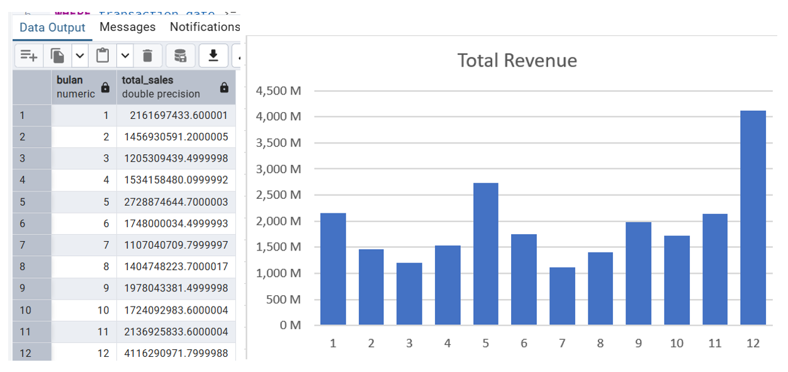
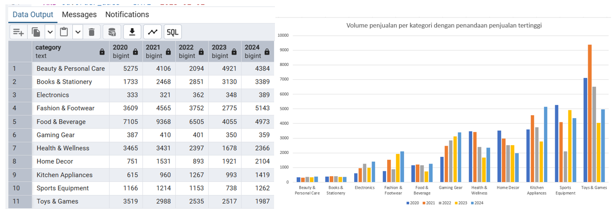
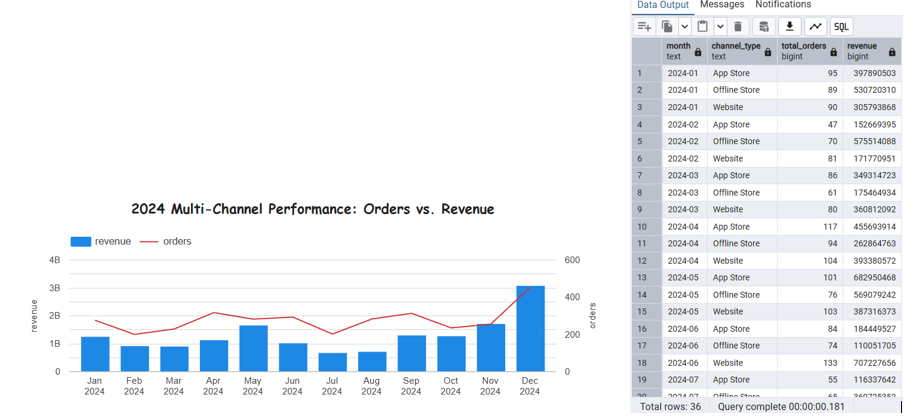
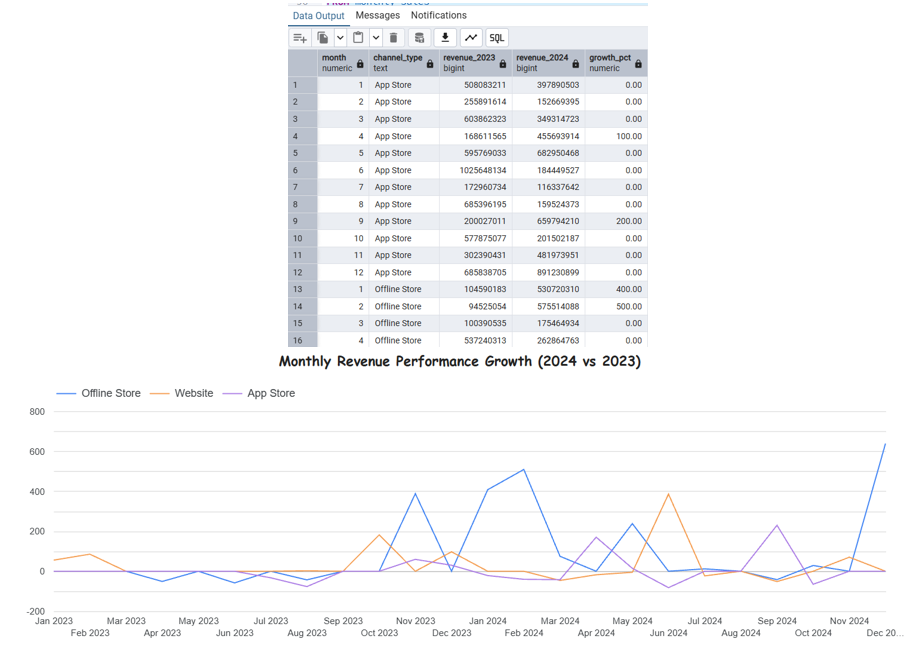
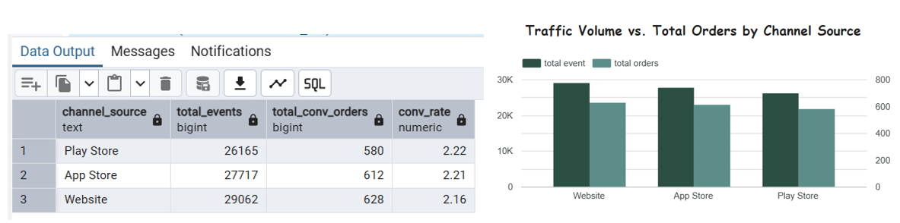
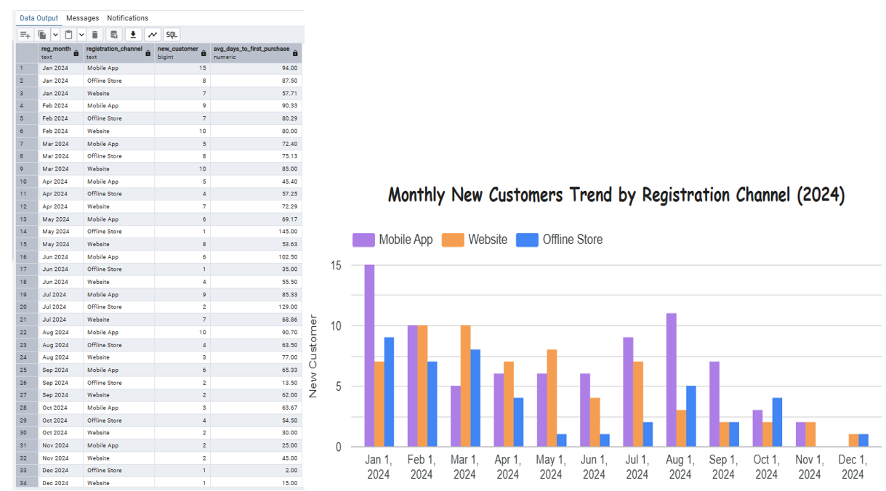

# ecommerce-business-performance-analysis
E-commerce Business Performance Analysis using SQL, Python and Looker Studio | MySkill Fullstack Data Analysis Final Project

## Business Problem

### Background
As an e-commerce business continues to grow, management needs a comprehensive understanding of its business performance across sales, customer behavior, product performance, payment methods, and marketing channels.

However, transaction data alone does not provide sufficient insights into the factors driving revenue, customer conversion, and overall business performance.

### Stakeholder Needs

| Stakeholder | Business Needs |
|---|---|
| Board of Directors (BoD) | Evaluate overall business performance, revenue growth, and profitability to support strategic decisions. |
| Marketing Team | Identify effective marketing channels and improve customer conversion rates. |
| Sales Team | Understand product and category performance to optimize sales strategies. |
| Product & Business Team | Identify high-performing and underperforming products to support product portfolio decisions. |
| Finance Team | Monitor revenue, discounts, costs, and profitability to improve financial performance. |

### Expected Outcome
This project is expected to deliver:
- A comprehensive overview of e-commerce business performance.
- Identification of key revenue and profitability drivers.
- Insights into customer purchasing behavior and marketing funnel conversion.
- Identification of underperforming products and business areas.
- Data-driven recommendations to improve revenue, profitability, and operational efficiency.

## Dataset Overview
This project uses a simulated Tokopedia e-commerce dataset provided by MySkill as part of the Fullstack Data Analysis Final Project.
The dataset consists of six tables containing information about orders, products, customers, payments, transactions, and marketing funnels.

| Table Name | Description |
|---|---|
| `order_detail` | Order and product-level transaction information |
| `product_detail` | Product attributes, categories, brands, and cost of goods sold (COGS) |
| `customer_detail` | Customer profile and registration information |
| `payment_detail` | Payment method information |
| `funnel_detail` | Customer funnel events and conversion information |
| `transaction_detail` | Transaction-level financial information |

## Table Schema

### 1. order_detail
| Column | Description |
|---|---|
| transaction_id | Unique transaction identifier |
| order_id | Unique order identifier |
| order_date | Order date |
| customer_id | Unique customer identifier |
| channel_type | Sales channel (web, app/play store, offline) |
| sku_id | Unique product identifier |
| quantity | Number of products purchased |
| price | Product unit price |
| before_discount | Total product price before discount |
| discount_item | Total product discount |
| after_discount | Total product price after discount |
| is_gross | Indicates unpaid orders |
| is_valid | Indicates paid orders |
| is_net | Indicates completed transactions (1) or return/cancel (0) |

### 2. product_detail
| Column | Description |
|---|---|
| sku_id | Unique product identifier |
| category | Product category |
| brand | Product brand |
| product | Product name |
| variant | Product variant |
| sku_name | Product SKU name |
| price | Product price |
| cogs | Cost of Goods Sold |

### 3. customer_detail
| Column | Description |
|---|---|
| customer_id | Unique customer identifier |
| registration_date | Customer registration date |
| customer_name | Customer name |
| customer_type | Customer classification |
| dob | Date of birth |
| province | Customer province |
| registration_channel | Customer registration channel |

### 4. payment_detail
| Column | Description |
|---|---|
| id | Payment method identifier |
| payment_method | Payment method name |

### 5. funnel_detail
| Column | Description |
|---|---|
| funnel_id | Unique funnel event identifier |
| sku_id | Product identifier |
| channel_source | Funnel channel source |
| funnel_date | Funnel event date |
| status | Funnel status |
| customer_id | Customer identifier |
| event | Customer funnel event |
| order_id | Order identifier |

### 6. transaction_detail
| Column | Description |
|---|---|
| transaction_id | Unique transaction identifier |
| transaction_date | Transaction date |
| customer_id | Customer identifier |
| payment_method | Payment method used |
| before_tax | Transaction amount before tax |
| tax | Tax amount |
| after_tax | Transaction amount after tax |
| shipping_cost | Shipping cost |
| transaction_discount | Transaction-level discount |
| total_paid | Total amount paid |

## Dataset Access

Below is the data used.

[Download Dataset – Google Drive](https://drive.google.com/drive/folders/1-6FNBiOsJpfUNIcAhcErJdefj6YQnQdV?usp=drive_link)

## Data Preparation

### Duplicate Data Check and Null Value Check
Duplicate records and null values were identified using SQL queries in PostgreSQL (pgAdmin).

The following query was used to identify potential duplicate records and null values in the **`customer_detail`**, **`funnel_detail`**, **`order_detail`**, **`payment_detail`**, **`product_detail`**, and **`transaction_detail`** tables.

**SQL Query:** [View SQL Script](./cek%20duplicate%20dan%20null.sql)

**Query Result:**

The query results were reviewed to identify duplicate records and null values that could potentially affect the accuracy of the analysis.

*(The following image shows an example of the query results for the duplicate and null value check in the `customer_detail` table.)*

## Business Case Studies & Analysis

### Case Study 1: Monthly Sales Performance Analysis

**Business Problem**
The Board of Directors requires a comprehensive overview of the company's monthly sales performance in 2024 to support business performance evaluation and strategic decision-making.

**Business Question**
How much total sales revenue was generated each month throughout 2024?

**Objective**
To analyze monthly sales performance by calculating total sales revenue based on the `total_paid` column in the `transaction_detail` table.

**Analysis Approach**
- Filter transaction data for the year 2024.
- Aggregate total sales revenue by month.
- Present the monthly sales performance from January to December 2024.

**SQL Query:** [View SQL Script](SQL_Script.sql)

 

### Case Study 2: Product Category Sales Trend Analysis

**Business Problem**
The Warehouse Manager requires an annual overview of sales volume by product category from 2020 to 2024 to support inventory planning and restocking decisions.

**Business Question**
How many units were sold for each product category annually from 2020 to 2024?

**Objective**
To analyze the annual sales volume (quantity) of each product category and identify category-level demand trends to support data-driven restocking decisions.

**SQL Query:** [View SQL Script](SQL_Script.sql)

**Query Result:**
The query results show the total quantity sold for each product category from 2020 to 2024.

 

**Key Findings:**
- **Food & Beverage** recorded the highest sales volume in 2020, 2021, and 2022.
- **Beauty & Personal Care** achieved the highest sales volume in 2023, with 4,921 units sold.
- **Fashion & Footwear** recorded the highest sales volume in 2024, with 5,143 units sold.
- Food & Beverage sales volume decreased from 9,368 units in 2021 to 4,973 units in 2024.
- Fashion & Footwear sales volume increased to 5,143 units in 2024, making it the leading category for that year.

**Business Recommendation:**
The Warehouse Manager may use these annual sales volume trends as a reference for restocking decisions. Categories with consistently high sales volume should be prioritized for inventory monitoring, while changes in category demand should be considered when adjusting stock levels.

### Case Study 3: Marketing Channel Performance & Revenue Growth Analysis

**Business Problem**
The Marketing Manager requires an analysis of channel performance across web, app, and offline channels in 2024 to evaluate order volume and revenue performance, as well as identify revenue growth compared to the same month in 2023.

**Business Question**
- How many distinct orders and how much revenue were generated by each channel per month in 2024?
- How did monthly revenue in 2024 grow compared to the same month in 2023?

**Objective**
To evaluate monthly marketing channel performance by analyzing distinct order volume, revenue after discount, and revenue growth year-over-year (YoY).

**Analysis Approach**
- Analyze valid transactions (`is_valid = 1`) from 2023 and 2024.
- Calculate the total distinct orders using `COUNT(DISTINCT transaction_id)`.
- Calculate revenue using `SUM(after_discount)`.
- Aggregate order volume and revenue by channel and month.
- Compare 2024 revenue with the corresponding month in 2023.
- Calculate revenue growth percentage year-over-year (YoY).

**SQL Query:** [View SQL Script](SQL_Script.sql)

**Query Result:**
The query results provide a monthly comparison of order volume and revenue across web, app, and offline channels, including revenue growth compared to the same month in the previous year.

### Case Study 4: Organic Funnel Conversion Analysis

**Business Problem**
The Marketing Manager requires an analysis of the organic funnel performance in 2024 to evaluate the effectiveness of organic acquisition channels in generating converted orders.

**Business Question**
- How many organic events were generated by each `channel_source` in 2024?
- How many unique orders were converted from organic events?
- What is the conversion rate for each organic channel source?

**Objective**
To evaluate the effectiveness of organic funnel channels by analyzing total organic events, unique converted orders, and conversion rates.

**Analysis Approach**
- Filter organic events (`event = 'Organic'`) during the period January 1 to December 31, 2024.
- Group the data by `channel_source`.
- Calculate the total number of organic events.
- Calculate the total unique converted orders using `COUNT(DISTINCT order_id)`.
- Calculate the conversion rate using the formula:

  `Conversion Rate = Total Unique Orders / Total Events × 100%`

- Rank channel sources based on their conversion rates.

**SQL Query:** [View SQL Script](SQL_Script.sql)

**Query Result:**
The query results provide an overview of organic funnel performance across different channel sources, including total events, unique converted orders, and conversion rates.

### Case Study 5: Customer Registration & First Purchase Analysis

**Business Problem**
The BI & CRM Lead requires a monthly report on customer registrations and the average time taken for registered customers to make their first purchase in 2024. The analysis will be used to optimize the customer onboarding process.

**Business Question**
- How many new customers registered each month by `registration_channel` in 2024?
- What is the average number of days between customer registration and their first purchase?
- How does the first purchase timeline vary across registration channels?

**Objective**
To evaluate customer acquisition and onboarding performance by analyzing monthly new customer registrations and the average time to first purchase.

**Analysis Approach**
- Filter customer registrations during January–December 2024.
- Identify the first valid transaction date for each customer.
- Include only customers who have completed at least one valid purchase.
- Count distinct new customers by month and registration channel.
- Calculate the average number of days between the actual registration date and first purchase date.

**SQL Query:** [View SQL Script](SQL_Script.sql)

**Query Result:**
The query results provide a monthly overview of new customer registrations by registration channel and the average time taken for customers to complete their first purchase.

## Business Conclusions & Recommendations

### Key Business Conclusions
Based on the analysis of the Tokopaedi e-commerce dataset, several key findings were identified:
1. **Monthly Sales Performance:** Sales performance in 2024 fluctuated throughout the year, with a significant increase in the fourth quarter and the highest revenue recorded in December.
2. **Category Sales Trends:** Food & Beverage, Beauty & Personal Care, and Fashion & Footwear were among the highest-volume categories. Fashion & Footwear showed significant growth in 2024.
3. **Channel Performance:** Revenue and order performance varied across channels, highlighting the need to evaluate channel performance consistently and identify periods of revenue decline.
4. **Organic Funnel Conversion:** Organic traffic volume and conversion rates differed across channel sources, indicating opportunities to improve conversion efficiency, particularly on channels with high event volume but relatively low conversion rates.
5. **Customer Acquisition & First Purchase:** Mobile App contributed the highest number of new registrations, while the average time to first purchase indicated opportunities to improve customer onboarding and activation.

### Business Recommendations
1. **Optimize Seasonal Sales Performance:** Prepare promotional campaigns, inventory, and operational capacity ahead of peak sales periods, particularly in the fourth quarter.
2. **Improve Inventory Planning:** Prioritize replenishment for high-demand categories while evaluating declining categories and managing low-volume products selectively.
3. **Enhance Channel Performance:** Investigate revenue declines across channels and replicate strategies from periods with stronger performance.
4. **Improve Organic Conversion:** Evaluate website user experience and checkout processes to reduce potential conversion barriers.
5. **Accelerate Customer Activation:** Develop onboarding campaigns, personalized offers, and automated reminders to encourage newly registered customers to make their first purchase sooner.

### Overall Conclusion
This analysis demonstrates how SQL-based data analysis can support business decision-making across sales performance, inventory planning, marketing channel optimization, organic funnel conversion, and customer acquisition. The findings provide a data-driven foundation for identifying business opportunities and developing more targeted strategies.
